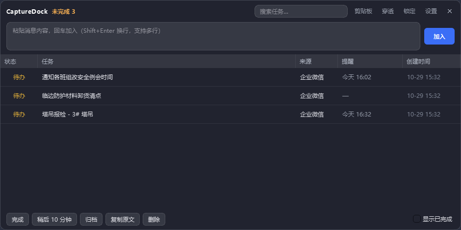

# CaptureDock v0.1

企业微信消息的桌面悬浮捕获工具。忙的时候看到消息，复制 → 快捷键呼出 → 粘贴回车 → 继续干活，之后再澄清。



## 启动

双击 `run.bat`，或：

```bash
.venv/Scripts/python.exe -m app.main
```

首次运行会在 `%APPDATA%\CaptureDock\` 下建 `tasks.db` 与 `settings.json`。

## 快捷键

| 快捷键 | 作用 |
|---|---|
| `Ctrl+Shift+Space` | 呼出窗口并聚焦输入框 |
| `Ctrl+Alt+P` | 切换鼠标穿透（穿透后窗口右上角有蓝色浮标，点一下也能恢复） |
| `Ctrl+Alt+R` | 还原默认大小与位置 |
| `Enter` | 加入一条 |
| `Shift+Enter` | 输入框内换行 |
| `Esc` | 收起窗口到托盘 |

## 操作

- **捕获**：粘贴消息 → 回车。多行会问「合并一条 / 拆成多条」。
- **剪贴板一键入库**：开启监听后复制内容，窗口出现提示条，点「加入待办」直接进表格，不用再点一次。
- **编辑**：双击任务列改任务名，双击状态列循环切换 待办→进行中→稍后→完成。
- **提醒**：双击提醒列，输入 `18:30` 或 `12-25 09:00`，留空取消。
- **状态双击**：双击状态列 = 完成 / 未完成 两态切换（一次双击收掉一条）；待办、完成、进行中、稍后任意状态双击都先跳到「完成」，再双击回到「待办」。
- **行操作**：右键菜单，或底部按钮（完成 / 稍后10分钟 / 归档 / 复制原文 / 删除）。
- **表格列**：状态 / 任务 / 提醒。不记来源和创建时间（对当下决策没用）。
- **数据目录**：设置里可指定 tasks.db 存放位置（如 D 盘、网盘同步目录）。切换时把现有任务复制过去，原文件保留作备份；`settings.json` 始终留在 `%APPDATA%\CaptureDock`。
- **选中态**：点行后有蓝色高亮，4 秒自动取消；点表格空白处也立即取消，不会一直挂着。
- **任务气泡**：任务列被截断时，鼠标悬停 350ms 弹出气泡显示完整原文；穿透状态下不弹。
- **底部操作条**：默认隐藏，选中某行才出现（完成 / 稍后 10 分钟 / 归档 / 复制原文 / 删除），取消选中即收起。
- **顶栏**：只有搜索框 + 4 个单字按钮（贴 / 透 / 锁 / 设）和 ✕，悬停有完整说明；未完成计数改到托盘提示。
- **显示已完成**：在表格右键菜单或托盘菜单里勾选。
- **自动收起**：默认关闭，加完任务窗口保持显示；需要时在设置里打开「捕获后 3 秒自动收起」。
- **拖动**：按住顶栏拖动；「锁定」后固定位置。
- **调整大小**：拖动窗口任意一边或四角即可缩放，最小可到 180×90，基本无限制。窗口大小和位置自动记忆。
- **还原默认尺寸**：`Ctrl+Alt+R`，或托盘右键 →「还原默认大小与位置」。缩太小/拖出屏幕时用它。默认 780×420。
- **透明度**：顶栏「设置」里 10%~80%，只影响背景，文字始终高对比。

## 边界

- 不读企业微信聊天记录，不做 UI 自动化，不注入企业微信。
- 纯本地 SQLite，无云同步、无账号体系。
- 剪贴板监听默认关闭，开启后只提示「加入待办？」，不自动入库。
- 鼠标穿透不跨会话恢复（防止重启后窗口点不到）。

## 技术

Python 3.13 + PySide6-Essentials（唯一依赖）+ 标准库 sqlite3。
全局快捷键直接调用 Win32 `RegisterHotKey`，不需要管理员权限。

## 后续

桌宠形态（idle / new_task / due_soon / all_done）尚未实现，`settings.mode` 字段已预留。

## 打包成 exe（分发给别人）

```bat
:: 1) 生成图标（只在图标要改时跑一次）
.venv\Scripts\python.exe tools\make_ico.py

:: 2) 打包
.venv\Scripts\pyinstaller.exe capture-dock.spec --noconfirm --clean --distpath dist --workpath build
```

产物：`dist\CaptureDock\CaptureDock.exe`（目录版，52MB）+ `dist\CaptureDock-win64.zip`（21.7MB，直接发给别人）。

说明：
- 用**目录版**不用 onefile：onefile 每次启动都要把 Qt 解压到临时目录，冷启动慢 2–4 秒，对一个常驻的快捷键工具不划算。
- spec 里剔除了 `opengl32sw.dll`(20MB)、OpenSSL、多余平台/图片插件、其余语言翻译，88MB → 52MB。
- 朋友解压后双击 exe 即可，不需要装 Python 或 PySide6。
- 数据仍写 `%APPDATA%\CaptureDock`，卸载就是删掉文件夹。
